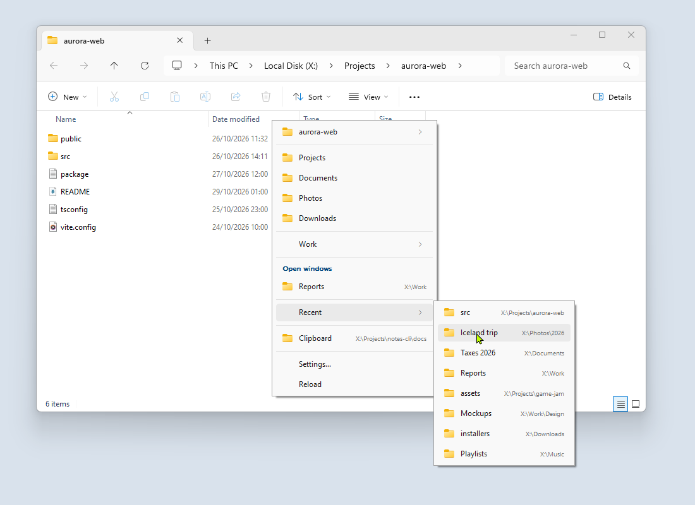
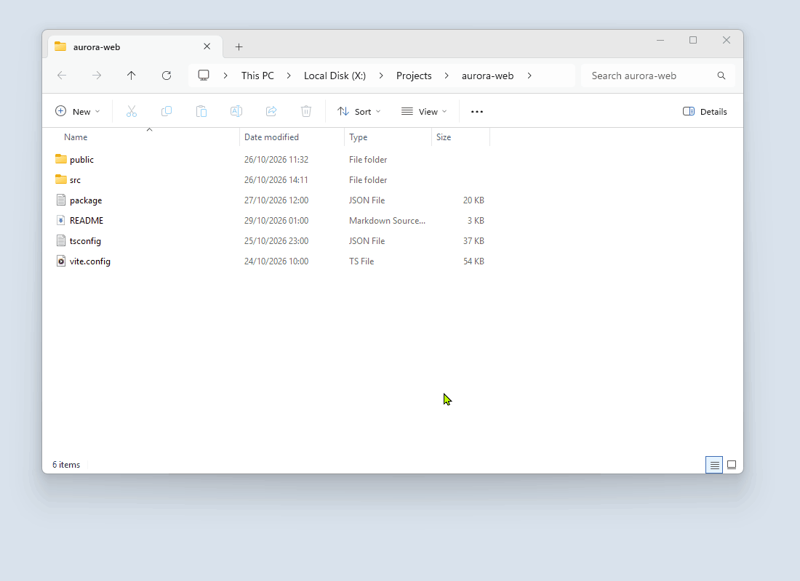
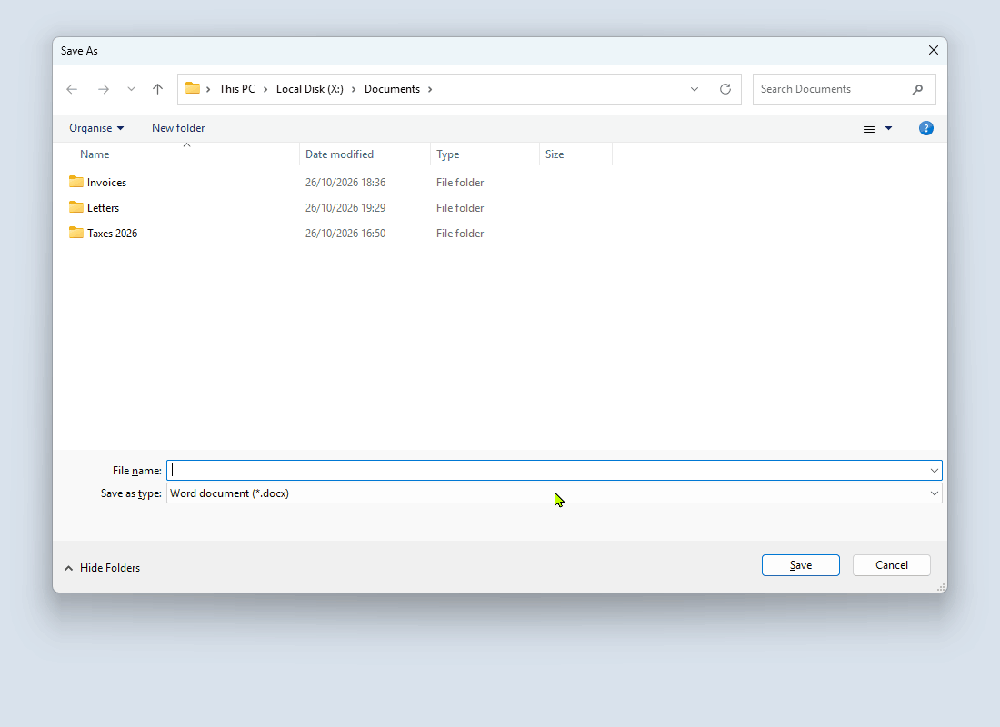
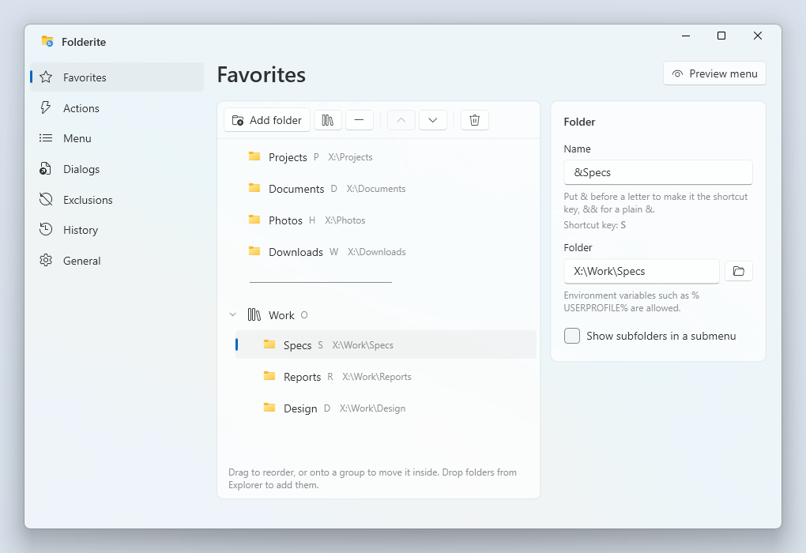

# Folderite

[](https://github.com/combwizard/Folderite/actions/workflows/ci.yml)
[](https://github.com/combwizard/Folderite/releases/latest)
[](LICENSE)
[](https://combwizard.github.io/Folderite/)
[](https://combwizard.github.io/Folderite/docs/)

Middle-click in a file manager or Open/Save dialog to pop up a folder menu: favorites, folders open in other windows, recent folders (frecency-ranked), and the folder on the clipboard. Picking one sends *that* window there.

<picture>
  <source media="(prefers-color-scheme: dark)" srcset="docs/images/menu-dark.png">
  
</picture>

Supported: Windows Explorer (incl. Win11 tabs), common file dialogs, Directory Opus, Total Commander, XYplorer, Blender's file browser window, and the desktop (opens a new Explorer window).

## Install

1. Install the [.NET 10 Desktop Runtime (x64)](https://dotnet.microsoft.com/download/dotnet/10.0) if you don't have it.
2. Download `Folderite-<version>-win-x64.zip` from the [latest release](https://github.com/combwizard/Folderite/releases/latest), unzip it to a folder of your choice, and run `Folderite.exe`.

To upgrade, quit Folderite from the tray and unzip the new release over the old folder. Your settings are kept.

Requires Windows 10 1903 or later; Windows 11 recommended.

## Build from source

Needs the [.NET 10 SDK](https://dotnet.microsoft.com/download/dotnet/10.0).

```bat
dotnet build
dotnet test
src\Folderite\bin\Debug\net10.0-windows\win-x64\Folderite.exe
```

## Documentation

The full guide is at [combwizard.github.io/Folderite/docs](https://combwizard.github.io/Folderite/docs/), built from [`docs/`](docs/).

## Usage

Runs in the tray. Right-click the tray icon for Settings, Pause, Start with Windows, Edit config, and Exit. Left-click opens the folder menu; picking a folder there opens a new Explorer window.

You can also open the menu with a keyboard shortcut: set one under **Settings → General → Keyboard shortcut**. It opens the menu for the window in front; if that isn't a supported window, picking a folder opens a new Explorer window.

Middle-click inside Explorer and pick a favorite or a recent folder:

<picture>
  <source media="(prefers-color-scheme: dark)" srcset="docs/images/explorer-dark.gif">
   Specs, then a recent folder">
</picture>

In an Open or Save dialog, the file name you typed is kept:

<picture>
  <source media="(prefers-color-scheme: dark)" srcset="docs/images/save-dialog-dark.gif">
   Reports; the typed file name stays">
</picture>

## Settings

**Settings…** (tray menu, or the bottom of the folder menu) opens an editor for everything below: favorites (drag to reorder or nest, drop folders from Explorer), actions, menu sections, exclusions, start folders for Open/Save dialogs, your folder history, Start with Windows / Pause, and the keyboard shortcut. Changes save as you make them and the running app picks them up immediately. **Preview menu** shows the real menu with the current settings.

<picture>
  <source media="(prefers-color-scheme: dark)" srcset="docs/images/settings-dark.png">
  
</picture>

Settings rewrites `config.json` when it saves, so `//` comments in it are not kept. If the file has an error, Settings stops saving until it is fixed.

## Config

`%APPDATA%\Folderite\config.json` by default. **Settings → General → Change location…** moves it, with `history.json`, to another folder (remembered in `HKCU\Software\Folderite\ConfigDirectory`); **Use default** moves it back. Choosing Folderite's own folder makes it **portable**: a `config.json` next to the exe always wins, so the settings travel with the folder. The file reloads automatically when saved. `//` comments and trailing commas are allowed.

```jsonc
{
  "favorites": [
    { "name": "&Projects", "path": "D:\\Projects", "showSubfolders": true },   // its subfolders in a submenu ("sortSubfolders": "newest" for newest first)
    { "name": "-" },                                   // separator
    { "name": "Work", "items": [                       // submenu
      { "name": "Specs", "path": "%USERPROFILE%\\Work\\Specs" }
    ]}
  ],
  "recentCount": 15,
  "historyExclude": ["C:\\Windows\\*", "*\\node_modules\\*"],
  "actions": [
    { "name": "Open &terminal here", "command": "wt.exe", "args": "-d \"{path}\"" },
    { "name": "Open in &VS Code",    "command": "code",   "args": "\"{path}\"" }
  ],
  "disabledProcesses": ["someapp"],   // exe names without .exe
  "showOpenWindows": true,
  "showClipboard": true,
  "enableOnDesktop": true,
  "showDrives": false,                // a Drives submenu with free space
  "hotkey": "Win+Shift+F",            // keyboard shortcut for the menu; "" = none
  "dialogLastFolder": false,          // open file dialogs in the folder last used in that app
  "dialogFolders": [                  // fixed start folders for one app's file dialogs
    { "app": "notepad", "path": "D:\\Notes" }
  ]
}
```

`&` marks the accelerator key in names. History lives in `history.json`, and errors are logged to `folderite.log`, both in the same folder.

Recent folders are ranked by how often and how recently you used them, with a boost for folders used in the app the menu is opened over.

## How it works

| Piece | File |
| --- | --- |
| Global middle-click hook (own thread, swallows down+up) | `Hooks/MouseHook.cs` |
| Window → adapter resolution | `Targets/TargetRegistry.cs` |
| Explorer: Shell.Application COM, active Win11 tab via `ShellTabWindowClass` | `Targets/ExplorerAdapter.cs` |
| File dialogs: breadcrumb caption to read; filename box + OK to navigate (address bar for folder pickers) | `Targets/FileDialogAdapter.cs` |
| Opus (`dopusrt`), TC (`WM_COPYDATA "CD"`), XYplorer (`WM_COPYDATA ::goto`) | `Targets/ThirdParty/` |
| Blender "File View" window: synthesized Ctrl+F, Shift+Tab, Ctrl+A, Ctrl+V, Enter into the path field (clipboard and cursor restored); current folder can't be read | `Targets/ThirdParty/BlenderAdapter.cs` |
| History from WinEvent name/foreground changes, zoxide-style frecency | `History/` |
| Menu model → owner-drawn native popup (dark mode, shell icons) | `Menu/` |
| Settings window (`Folderite.exe --settings`, WPF + Fluent), separate process | `Settings/` |
| Settings ↔ tray app: pause and history over `WM_COPYDATA` | `Interop/Ipc.cs` |

## Manual test checklist

The list of what to try by hand before a release is in [Build from source](docs/building.md#manual-test-checklist).

## Screenshots

Every screenshot and animation in `docs/images/` exists in a light and a dark version (`<name>-light.*`, `<name>-dark.*`); the README and the website pick one by the viewer's theme. To retake them, switch Windows to light mode and run `pwsh tools\screenshots\capture.ps1`, then switch to dark mode and run it again. It drives a demo setup with made-up folders on a temporary `X:` drive and takes over the mouse for about a minute.

## Releasing

Push a version tag; the [Release workflow](.github/workflows/release.yml) tests, publishes, and attaches `Folderite-<version>-win-x64.zip` to a draft release with that tag. Edit the notes and publish it.

```bat
git tag v0.3.0
git push origin v0.3.0
```

The version comes from the tag, not `Folderite.csproj`. A tag with a suffix (`v0.3.0-beta.1`) makes a pre-release. If a release for the tag already exists, the zip is added to it instead.

## Inspiration

Folderite is mainly inspired by [Direct Folders](https://www.codesector.com/directfolders), which first offered a middle-click folder menu for Explorer and file dialogs. Later on, [Listary](https://www.listary.com/) also shaped it, especially in how it jumps between open folders and recent folders.

## License

[MIT](LICENSE)
